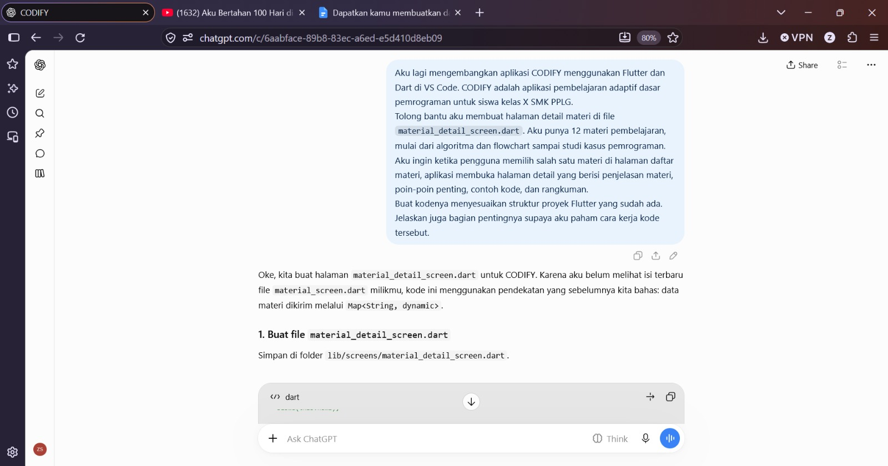
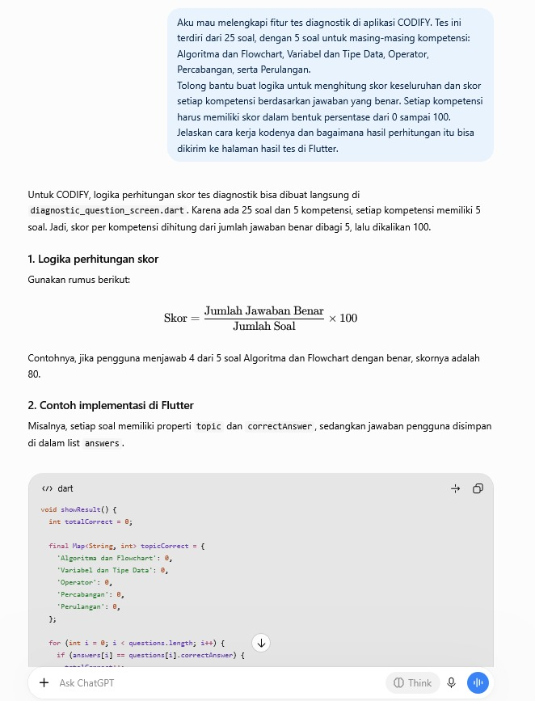

# AI Declaration

**Proyek UTS Mobile Programming — CODIFY**

Dokumen ini menjelaskan penggunaan alat berbasis kecerdasan buatan (AI) sebagai pendukung proses pengembangan aplikasi CODIFY. AI digunakan untuk membantu memberikan ide, contoh kode, dan penjelasan. Tanggung jawab untuk memahami, meninjau, menyesuaikan, dan menguji kode tetap berada pada mahasiswa.

## 1. Identitas Mahasiswa dan Proyek

| Keterangan | Detail |
|---|---|
| Nama | Zahra Salsabila |
| NPM | 2413025025 |
| Program Studi/Kelas | Pendidikan Teknologi Informasi / PTI 2024A |
| Mata Kuliah | Mobile Programming |
| Nama aplikasi | CODIFY |
| Judul proyek | Aplikasi Pembelajaran Adaptif Dasar Pemrograman Berbasis Mobile untuk Siswa Kelas X SMK PPLG |
| Repository | https://github.com/zahraslsa/aplikasi_pertama |

## 2. Alat AI yang Digunakan

- **ChatGPT** digunakan untuk meminta bantuan menyusun solusi, menjelaskan konsep dan kode Flutter/Dart, serta membantu memahami alur fitur aplikasi.
- **GitHub Copilot** digunakan sebagai bantuan penulisan kode di editor, sesuai dengan penggunaannya selama pengembangan.

## 3. Contoh Prompt dan Bukti Penggunaan AI

Dua prompt berikut digunakan sebagai contoh dokumentasi bantuan AI untuk pengembangan CODIFY.

### Prompt 1 — Pembuatan Halaman Detail Materi

> Aku lagi mengembangkan aplikasi CODIFY menggunakan Flutter dan Dart di VS Code. CODIFY adalah aplikasi pembelajaran adaptif dasar pemrograman untuk siswa kelas X SMK PPLG. Tolong bantu aku membuat halaman detail materi di file `material_detail_screen.dart`. Aku punya 12 materi pembelajaran, mulai dari algoritma dan flowchart sampai studi kasus pemrograman. Aku ingin ketika pengguna memilih salah satu materi di halaman daftar materi, aplikasi membuka halaman detail yang berisi penjelasan materi, poin-poin penting, contoh kode, dan rangkuman. Buat kodenya menyesuaikan struktur proyek Flutter yang sudah ada. Jelaskan juga bagian pentingnya supaya aku paham cara kerja kode tersebut.

**Bukti screenshot:**

### Prompt 2 — Perhitungan Skor Tes Diagnostik

> Aku mau melengkapi fitur tes diagnostik di aplikasi CODIFY. Tes ini terdiri dari 25 soal, dengan 5 soal untuk masing-masing kompetensi: Algoritma dan Flowchart, Variabel dan Tipe Data, Operator, Percabangan, serta Perulangan. Tolong bantu buat logika untuk menghitung skor keseluruhan dan skor setiap kompetensi berdasarkan jawaban yang benar. Setiap kompetensi harus memiliki skor dalam bentuk persentase dari 0 sampai 100. Jelaskan cara kerja kodenya dan bagaimana hasil perhitungan itu bisa dikirim ke halaman hasil tes di Flutter.

**Bukti screenshot:**

## 4. Peran Mahasiswa dan Pemeriksaan Hasil AI

Saya menentukan kebutuhan aplikasi, memilih saran yang relevan, lalu menyesuaikan kode dengan struktur proyek. Saya juga perlu membaca dan memahami kode serta memeriksa hasilnya dengan menjalankan aplikasi di emulator. Saran AI tidak selalu langsung cocok dengan proyek karena nama variabel, bentuk data, atau struktur widget dapat berbeda. Oleh karena itu, hasil AI perlu ditinjau dan diuji sebelum digunakan.

## 5. Evaluasi Kritis Penggunaan AI

AI membantu mempercepat pencarian contoh implementasi dan memberi penjelasan saat saya menemui kesulitan. Namun, kode yang diberikan dapat memerlukan penyesuaian dan tidak boleh langsung dianggap benar. Saya bertanggung jawab memahami alur aplikasi, menguji fitur yang didemonstrasikan, dan menjelaskan kode saat presentasi. Fitur hanya dinyatakan selesai jika memang sudah berjalan berdasarkan pengujian yang dilakukan.

## 6. Pernyataan Integritas Akademik

Saya menyatakan penggunaan AI secara terbuka dan tidak mengklaim bahwa seluruh kode dibuat tanpa bantuan AI. Saya tetap bertanggung jawab atas isi, fungsi, dan penjelasan aplikasi yang dikumpulkan. Keterangan pada dokumen ini harus sesuai dengan proses pengembangan dan penggunaan alat yang sebenarnya.

