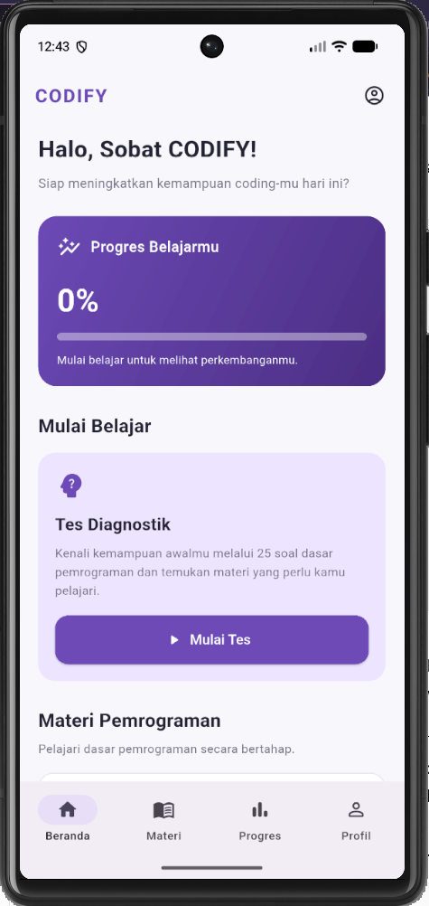
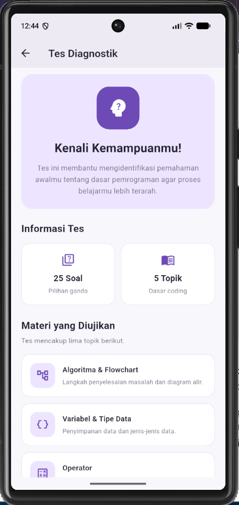
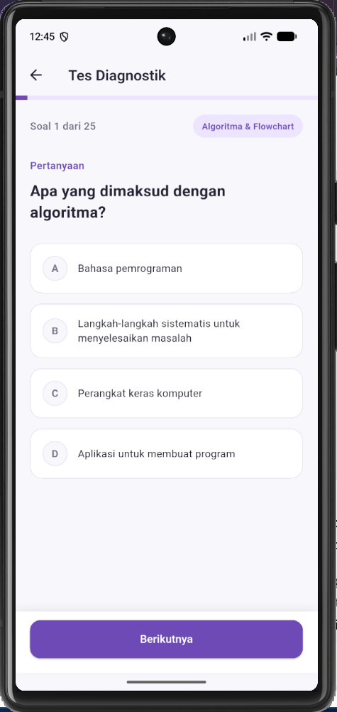
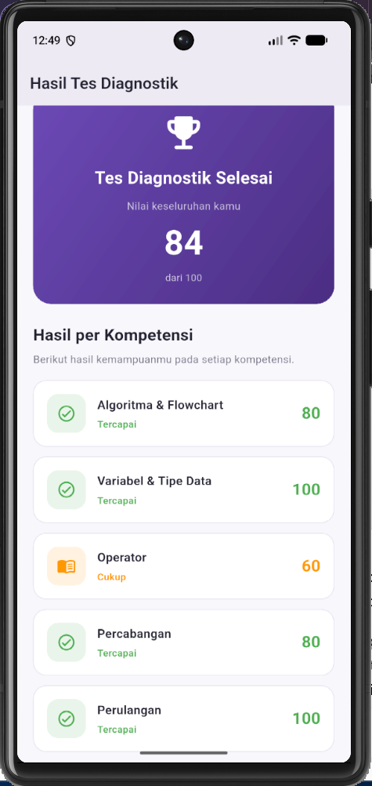
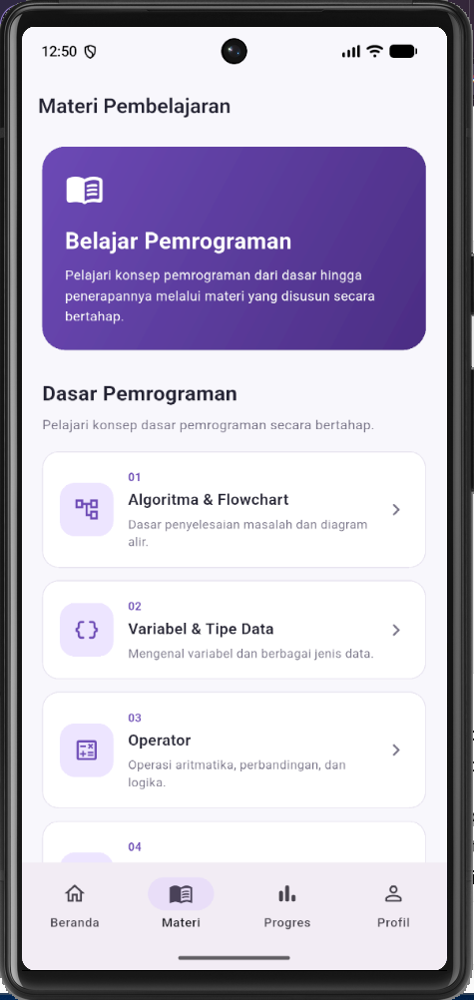
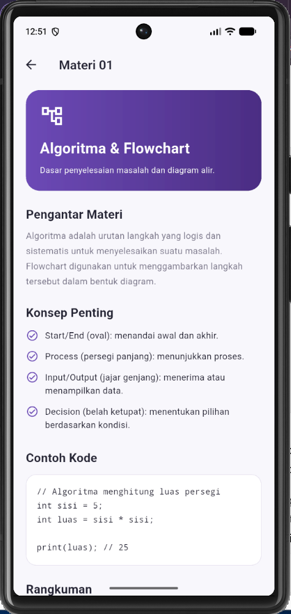
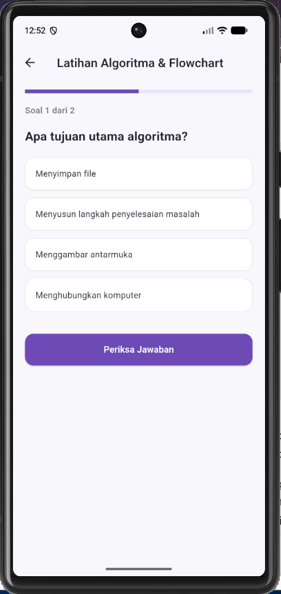
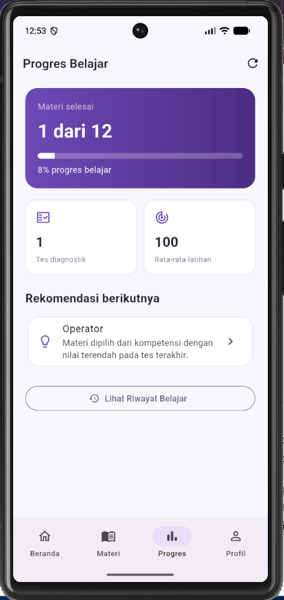
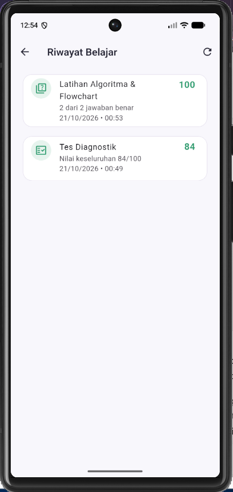
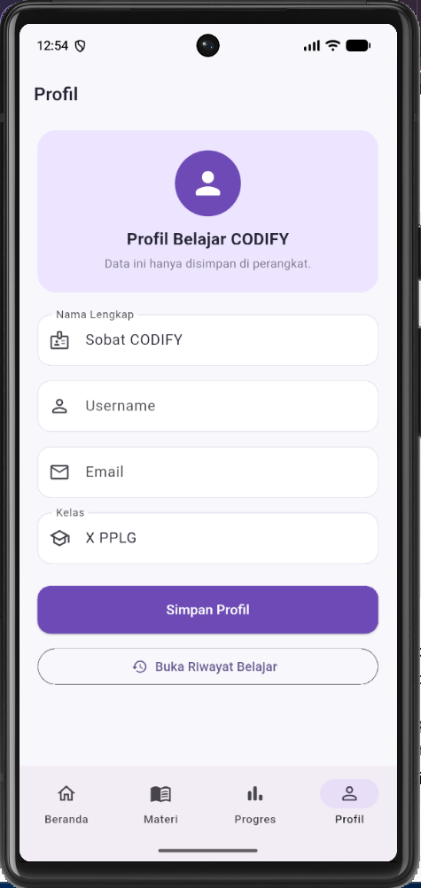

# CODIFY

**Aplikasi Pembelajaran Adaptif Dasar Pemrograman Berbasis Mobile untuk Siswa Kelas X SMK PPLG**

CODIFY merupakan prototipe aplikasi pembelajaran mobile yang dirancang untuk membantu siswa kelas X SMK PPLG mempelajari dasar pemrograman. Aplikasi ini menggabungkan tes diagnostik, hasil tes, materi pembelajaran, latihan, dan pemantauan progres belajar.

## Fitur Aplikasi

Fitur berikut didokumentasikan berdasarkan struktur proyek. Pastikan status setiap fitur sudah sesuai dengan hasil pengujian pada emulator sebelum pengumpulan.

- Dashboard sebagai halaman utama.
- Tes diagnostik dengan 25 soal yang mencakup lima kompetensi.
- Hasil tes berupa skor keseluruhan dan skor per kompetensi.
- Daftar materi dan halaman detail materi.
- Latihan materi.
- Halaman progres belajar dan riwayat belajar.
- Halaman profil pengguna.

## Kompetensi Tes Diagnostik

Tes diagnostik dirancang untuk mencakup lima kompetensi dasar pemrograman:

1. Algoritma dan Flowchart
2. Variabel dan Tipe Data
3. Operator
4. Percabangan
5. Perulangan

Setiap kompetensi memiliki lima soal. Skor kompetensi dihitung sebagai persentase dari 0 sampai 100.

## Materi Pembelajaran

Aplikasi memuat 12 topik materi yang direncanakan:

1. Algoritma dan Flowchart
2. Variabel dan Tipe Data
3. Operator
4. Percabangan
5. Perulangan
6. Array
7. Function/Method
8. String dan Manipulasi Data
9. Input dan Output
10. Debugging
11. OOP Dasar
12. Studi Kasus Pemrograman

## Screenshot Aplikasi

Screenshot berikut diambil dari aplikasi yang dijalankan di emulator. Pastikan nama file pada folder `screenshots/` sama persis dengan yang dirujuk di bawah.

### Dashboard


### Tes Diagnostik


### Soal Diagnostik


### Hasil Tes


### Daftar Materi


### Detail Materi


### Latihan Materi


### Progres Belajar


### Riwayat Belajar


### Profil


## Teknologi

- Flutter
- Dart
- Visual Studio Code
- Android Emulator

CODIFY dikembangkan sebagai prototipe yang dirancang untuk berjalan secara offline. README ini tidak menyatakan bahwa Firebase atau database online sudah digunakan.

## Struktur Proyek

Struktur ringkas berdasarkan folder proyek:

```text
aplikasi_pertama/
├── lib/
│   ├── data/
│   ├── screens/
│   ├── theme/
│   ├── widgets/
│   └── main.dart
├── screenshots/
│   ├── ai/
│   ├── dashboard.png
│   ├── daftar-materi.png
│   ├── detail-materi.png
│   ├── hasil-tes.png
│   ├── latihan-materi.png
│   ├── profil.png
│   ├── progres-belajar.png
│   ├── riwayat-belajar.png
│   ├── soal-diagnostik.png
│   └── tes-diagnostik.png
├── README.md
└── AI_DECLARATION.md
```

## Cara Menjalankan Aplikasi

Pastikan Flutter SDK dan Android Emulator sudah terpasang. Jalankan perintah berikut dari terminal pada folder proyek:

```bash
flutter pub get
flutter devices
flutter run -d emulator-5554 --no-enable-impeller
```

Jika ID emulator berbeda, gunakan ID yang ditampilkan oleh `flutter devices`.

Untuk memeriksa kode:

```bash
flutter analyze
```

## Repository

https://github.com/zahraslsa/aplikasi_pertama
